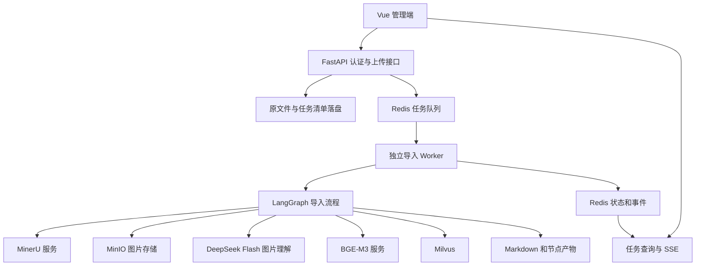
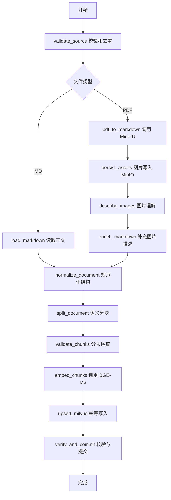

# 管理员登录与知识库导入技术方案

本阶段建设管理员登录和 PDF/Markdown 文档导入两个模块。管理员上传文件后，页面持续展示处理步骤；后端通过 LangGraph 完成文档解析、图片增强、语义分块、BGE-M3 向量化和 Milvus 入库。

本方案已进入开发，登录、导入及页面代码已实现，外部服务由用户后续在云端部署。本阶段不部署中间件、不创建测试用例；实际运行配置与验证边界见 [运行说明](admin-import-operations.md)。下文的设计默认值已用于首版实现。

## 1. 已确认范围与建议默认值

### 1.1 已确认

| 项目 | 约定 |
| --- | --- |
| 管理员账号 | 从 `.env` 读取 `ADMIN_USERNAME`、`ADMIN_PASSWORD`，单管理员 |
| 前端 | Vue，提供登录页面和带实时进度的导入页面 |
| 后端 | Python、FastAPI、LangChain、LangGraph；Python 依赖统一使用 uv |
| 文件 | 只支持 `.pdf`、`.md` |
| PDF 解析 | 调用独立部署的 MinerU 服务；本地开发先连接本机服务地址 |
| 图片理解 | 使用支持图片输入的 `deepseek-flash` |
| Embedding | 使用独立部署的 BGE-M3 服务，开发时连接本机，之后部署到阿里云服务器 |
| 图片存储 | MinIO 读写 |
| Markdown 产物 | 项目根目录下 `docs/pdfToMd/` |
| 向量库 | Milvus |
| 缓存和任务通知 | Redis |
| HTTP 接口数量 | 按模块需要拆分，不限制为两个接口 |

### 1.2 建议默认值

以下是本版方案的初始建议，可在实现前调整，不属于用户已经确认的业务规则。

| 项目 | 建议 |
| --- | --- |
| 首版部署 | 单台服务器、单个导入 Worker、同时处理 1 个文件，其他任务排队 |
| 上传 | 每次一个文件，文件大小上限 20 MiB，PDF 页数上限建议 200；页数在解析前后按实际可获得信息校验 |
| 管理会话 | Redis 保存随机会话，固定有效期 8 小时，退出立即失效 |
| 图片失败 | 重试后仍失败则任务失败，不静默丢弃图片信息 |
| 重复文件 | 相同文件哈希及处理配置版本，复用已有成功结果或返回正在执行的任务 |
| 历史 | 首版保留上传、解析和处理结果，暂不做自动删除 |
| MD 图片 | 单独上传的 MD 暂不自动抓取外部 URL 或读取服务器本地路径；保留引用并提示图片未增强 |
| 更新与删除 | 首版不做文档覆盖、版本切换和删除；不同内容按新文档处理 |

后续若需要 MD 附带本地图片上传、文件更新替换或跨服务器多 Worker，需要扩展对应协议，不能通过猜测文件路径实现。

## 2. 总体架构



API 进程负责认证、文件接收、任务创建及进度读取，不在 HTTP 请求内执行完整解析和向量化。Worker 负责长任务，避免上传请求超时、页面关闭导致任务中断，以及开发服务器重载丢失进程内后台任务。

首版复用已有 Redis，通过 Streams 消费组传递任务，完成处理后 ACK；进度事件使用另外的 Stream，页面通过 SSE 读取事件。Redis Streams 支持待确认消息和消费确认，但任务仍可能重复投递，必须配合幂等设计。[Redis 文档](https://redis.io/docs/latest/commands/xreadgroup/)

首版不新增关系数据库：Redis 保存运行状态，磁盘任务清单和阶段产物提供恢复依据。Redis 开启持久化；如果本机磁盘与 Redis 同时损坏，不能承诺无损恢复，需要部署备份。

## 3. 管理员登录

### 3.1 流程

1. 后端从环境变量读取管理员账号密码；缺少任一配置时，管理登录不可用，启动日志只说明缺少配置名。
2. 浏览器提交账号密码，后端校验，失败统一返回“账号或密码错误”，不暴露具体错误字段。
3. 登录成功生成高熵随机会话 ID，Redis 保存会话摘要、创建时间、过期时间和凭据配置指纹；指纹使用服务端密钥计算，不保存原始密码。凭据变更后旧会话失效。
4. Cookie 保存会话 ID，设置 `HttpOnly`、`SameSite=Strict`、`Path=/`；生产 HTTPS 设置 `Secure`，本机 HTTP 开发允许关闭 Secure。
5. 所有管理接口、SSE、产物预览和图片读取都校验会话；退出删除 Redis 会话并清理 Cookie。

首版使用服务端会话，不增加用户表、注册、角色或 JWT 刷新流程。密码校验使用安全比较方式；密码、Cookie、完整请求头不进入日志。登录失败按来源限流，日志中的来源标识脱敏。

浏览器与 API 生产环境同源部署，开发由 Vite 代理 `/api`。修改状态的接口校验 Origin，并使用会话绑定的 CSRF Token；登录后通过当前会话接口获取 Token。登录接口同样校验来源。Redis 不可用时，管理鉴权和提交任务返回明确的服务不可用错误。

## 4. HTTP 接口草案

统一前缀为 `/api/v1/admin`。除登录外均需管理员会话；登录、当前会话和任务响应使用 `Cache-Control: no-store`。

| 方法 | 路径 | 职责 |
| --- | --- | --- |
| POST | `/auth/login` | JSON 提交账号密码，设置会话 Cookie |
| GET | `/auth/me` | 查询当前登录状态、过期时间和 CSRF Token |
| POST | `/auth/logout` | 销毁当前会话 |
| POST | `/imports` | multipart 上传单个 PDF/MD，校验并创建异步任务 |
| GET | `/imports` | 分页查询最近任务及状态 |
| GET | `/imports/{task_id}` | 完整任务快照、步骤状态、计数、错误和产物信息 |
| GET | `/imports/{task_id}/events` | SSE 进度流，支持事件游标恢复 |
| POST | `/imports/{task_id}/retry` | 对失败或中断任务发起一次新的执行尝试 |
| GET | `/imports/{task_id}/markdown` | 读取或下载原始/增强 Markdown；未产出时返回明确状态 |
| GET | `/assets/{asset_id}` | 校验权限后从 MinIO 代理读取图片，避免公开存储桶 |

上传正常接受时返回 `202 Accepted`，示意如下：

```json
{
  "task_id": "服务端生成的任务标识",
  "document_id": "服务端生成的文档标识",
  "status": "queued",
  "reused": false
}
```

命中已有成功结果返回 `200` 和原任务，`reused=true`；命中正在处理的相同文件返回原任务，不新增向量。文件太大返回 413，格式不支持返回 415，空文件/无有效正文返回 422，重复的重试操作返回 409，未登录返回 401，CSRF 校验失败返回 403，限流返回 429，依赖服务不可用返回 503。

所有错误统一包含 `code`、可展示的 `message`、`request_id`，任务失败另外提供 `failed_node` 和 `retryable`。不能把服务堆栈、密钥或内部完整 URL 原样返回前端。

## 5. 上传与本地产物

上传流式写入项目的 `data/imports/{task_id}/source.pdf` 或 `source.md`，边写边计算 SHA-256 并限制大小。不信任客户端文件名和 Content-Type；检查扩展名与内容一致性、MD 文本编码、空内容、PDF 可解析性及加密状态。客户端原文件名只用于脱敏显示，不参与路径拼接。

任务清单先以临时文件写入再原子替换；任务入队时在 Redis 原子写入快照与队列消息。若落盘后入队失败，不返回“已接受”，重试时识别已有记录；Worker 启动时协调处理中但未完成的任务。API 返回成功前必须完成持久化和入队确认。

产物目录从项目根路径解析，不依赖启动时的工作目录：

```text
docs/pdfToMd/{document_id}/{ingest_id}/
  original.md          # MinerU 输出或直接上传的 MD
  enriched.md          # 已增强图片描述的正文
data/imports/{task_id}/
  source.pdf 或 source.md
  manifest.json        # 任务、配置指纹、状态与阶段结果引用
  parser-result.json   # 解析后的来源信息与图片映射
  assets.json          # 图片对象键、哈希、页码与描述
  chunks.jsonl         # 切分结果及来源元数据
```

目录在真实任务执行时按需创建，`docs/pdfToMd/` 已加入 Git 忽略规则。原文与增强版本分别保存，不能用模型结果覆盖唯一的原文。当前实现以 `chunks.json` 保存分块清单，其他路径保持上述职责。

## 6. LangGraph 导入流程



| 节点 | 输入和职责 | 产出及关键失败条件 |
| --- | --- | --- |
| `validate_source` | 复核文件哈希、限制、配置指纹及重复任务 | 文件描述；损坏或不支持则失败 |
| `pdf_to_markdown` | 调用独立 MinerU，等待解析结果，取得 MD、图片及结构信息 | 原始 MD、图片清单和来源映射；超时/解析空正文则失败 |
| `load_markdown` | 解码上传的 MD，识别标题、图片引用和文本块 | 原始 MD；缺失的本地图片引用记为警告 |
| `persist_assets` | 读取解析图片，校验实际格式和大小，按哈希写入 MinIO | 对象键、图片哈希及来源映射；存储失败则失败 |
| `describe_images` | 通过 MinIO 获取图片字节，携带相邻正文请求 DeepSeek Flash | 每张图片的实体、关系、可读文字和摘要；不推断图片之外的经历 |
| `enrich_markdown` | 保留原图，补充 alt 描述及用于检索的图片文字说明 | `enriched.md` 与增强来源标记 |
| `normalize_document` | 识别标题、段落、列表、代码、表格、图片；有限清理噪声 | 有序结构块；不随意删除重复出现的业务内容 |
| `split_document` | 标题分节、长节递归、短节贪心合并 | 有来源映射的 chunk 列表 |
| `validate_chunks` | 检查空块、重复块、token 上限、图片说明和正文覆盖 | 合法 chunk 清单；无内容或不可容纳的块明确报错 |
| `embed_chunks` | 分批调用 BGE-M3，检查向量条数、维度和数值 | 归一化向量或明确的服务错误 |
| `upsert_milvus` | 校验 collection schema，按稳定主键分批 upsert | 已写入 chunk 主键；记录已确认批次 |
| `verify_and_commit` | 校验实际实体、维度和读取可见性，提交完整导入版本 | 文档可用记录；最后才发送成功和 100% |

图片不存在的 PDF 将相关节点标记为 `skipped`，直接进入规范化。MD 上传不伪造 MinerU 页码，页码为空并使用行号定位。

图状态仅存任务 ID、文档 ID、配置指纹、产物路径、步骤、计数和错误摘要，不放密码、图片 base64 或完整向量。节点内事件用于发送批次进度；LangGraph 支持节点更新及自定义进度事件，但事件流本身不是持久化任务系统。[LangGraph 流式文档](https://docs.langchain.com/oss/python/langgraph/streaming)

## 7. MinerU 与图片增强

MinerU 以独立 HTTP 服务适配，本地通过 `MINERU_BASE_URL` 指向本机，服务器通过配置切换到内网地址。未提供实际版本和 OpenAPI 前，不把网上某个版本的路径和字段直接作为实现事实；适配器对外统一返回 Markdown、图片文件和来源映射，内部匹配实际部署的同步或异步接口。

若服务返回 ZIP，限制解压总大小、文件数和路径，拒绝路径穿越及非预期文件。图片必须在任务输出清理前复制到本项目 MinIO，不能把临时服务目录当作长期图片地址。MinerU 的标准结果可包含 Markdown、结构 JSON 和 `images/`，具体可取格式由部署入口决定。[MinerU 输出文档](https://github.com/opendatalab/MinerU/blob/master/docs/en/reference/output_files.md)

MinIO 建议使用独立私有桶 `askme-assets`，对象键示意为 `documents/{document_id}/{ingest_id}/images/{sha256}.{ext}`。永久保存桶名与对象键，不在 Markdown 或 Milvus 中保存会过期的签名 URL。管理页面通过受鉴权的图片代理访问，DeepSeek 调用默认通过 base64 传图，不要求本机 MinIO 暴露公网。DeepSeek Flash 官方支持 base64 图片输入。[DeepSeek 图片文档](https://api-docs.deepseek.com/guides/vision/)

对于 HTML 图片使用 ``；对于 Markdown 图片保留等价的替代文本。所有模型输出按文本转义，禁止作为 HTML 原样拼接。

切分器必须将 alt 与必要的图片文字说明提取到检索文本，不能只保留标签后又在清洗时删除。图片说明紧邻原图，元数据标记 `source_type=image_description` 和 `asset_id`，使后续回答能够区分原文与模型补充。正文展示时使用受限、净化后的 Markdown/HTML 渲染，阻止脚本、事件属性和危险 URL。

相同图片哈希和识别模型/提示词版本可复用描述，减少重复调用。装饰性图像的跳过规则需要明确可解释，首版不以不透明的启发式规则静默丢图。

## 8. 文档切分规则

### 8.1 长度口径

长度统一按 BGE-M3 对应 tokenizer 的 token 数计量，不能把中文字符数直接当作 token 数。建议首版参数为：目标 `chunk_size=700`、软性短块阈值 `min_chunk_size=180`、硬上限 `max_chunk_size=1000`、同节长块重叠 `chunk_overlap=80`。这些值需要以实际简历和项目文档调优。

BGE-M3 的标准稠密向量是 1024 维，最大输入长度为 8192 tokens；长输入能力不意味着每块都应填满 8192。标题前缀、图片说明和特殊 token 一并纳入服务有效输入上限。[BGE-M3 模型卡](https://huggingface.co/BAAI/bge-m3)

### 8.2 执行顺序

1. 用 Markdown 结构解析构建标题树，保留 H1 至 H6、标题路径和块位置。识别 Setext 标题；代码围栏中的 `#` 不作标题。无标题文本归入文档根节点。
2. 每个章节先作为候选块，保留父标题上下文，不将嵌套章节的正文重复分配给父块。
3. 超过目标大小的章节，按段落、列表项、句子、token 窗口逐级递归切分。代码块和表格优先保持完整，超限时按行或表格行拆分并携带必要表头/代码语言，标记发生了结构拆分。
4. 图片与图片说明作为相关单元，必要时附到相邻正文。超长说明按句拆分并保留相同 `asset_id`。
5. 对相邻短候选块执行贪心合并，优先同一章节，允许同一父标题下相邻兄弟章节在容量内合并；禁止跨文档或跨不同顶级主题。合并后仍保留各标题和来源范围。
6. 合并以接近目标大小为准，不能超过硬上限；无法合理合并的短节允许保留，不为满足最小长度拼接无关内容。
7. 重叠只用于同一长章节的相邻切片，尽量沿完整句子，预留容量；不跨无关标题机械复制 80 tokens。
8. 最后复核实际 token 数、标题前缀和模型上限，给每个 chunk 生成稳定主键与 `section_paths`、来源范围。

LangChain 的 Markdown 标题切分器可辅助记录标题元数据，但表格、代码、图片和短节合并规则需要补充结构处理，不能仅凭正则或单个长度切分器承诺语义完整。[LangChain 文档](https://docs.langchain.com/oss/python/integrations/splitters/markdown_header_metadata_splitter)

## 9. BGE-M3 与 Milvus

### 9.1 Embedding 服务契约

BGE-M3 由独立服务加载模型，FastAPI 和 Worker 不直接加载权重，也不安装整套 GPU 推理运行时。配置服务地址、鉴权和模型名；切换到阿里云时保留同一接口契约。

建议本地服务提供 OpenAI 兼容的 embeddings 接口，输入模型名及文本列表，输出按索引排列的 1024 维稠密向量。如果实际采用 TEI、Infinity 或其他不同协议，只替换适配器，不修改导入图。此接口形态是建议契约，需在服务选定后确认。

服务端必须明确 tokenizer、模型版本和截断行为，禁止对超长输入静默截断。客户端以实际 tokenizer 计数；可通过轻量 tokenizer 本地计数或由服务提供计数能力，无需在 API 进程加载模型权重。记录模型版本与归一化方式，文档和未来查询使用相同语义空间。

建议每批 16 个 chunk 起步，按服务吞吐调优；检查返回索引、条数、1024 维、有限数值和非零范数，统一做 L2 归一化，检索度量使用 COSINE。首版只使用 BGE-M3 的 dense 输出，稀疏及多向量混合检索留待后续。

### 9.2 Collection 草案

建议 collection 名为 `askme_chunks_bge_m3_v1`，字段如下：

| 字段 | 类型或职责 |
| --- | --- |
| `chunk_id` | VARCHAR 主键，不自动生成；由 ingest_id、chunk_index、文本哈希稳定生成 |
| `document_id`、`ingest_id` | 文档与一次完整导入版本标识 |
| `chunk_index` | 文档内顺序 |
| `text` | 可供检索和回答引用的完整 chunk 正文 |
| `embedding` | FLOAT_VECTOR，1024 维 |
| `metadata` | JSON：标题路径、原文件名、来源类型、页码/行号范围、图片 ID、模型和切分版本等 |

文本和 JSON 长度按 UTF-8 字节限制校验，不能只按 token 数配置 VARCHAR。主键和元数据采用受控值，过滤表达式不能直接拼接用户输入。

服务端版本未提供前，不固定索引类型和参数；实现时根据 Milvus 实际版本和数据规模选择支持的索引，候选为 HNSW + COSINE。现有 PyMilvus 版本也需与服务端版本验证兼容。

### 9.3 幂等与完成条件

文件哈希 + 处理流水线版本 + 模型版本 + 切分参数形成去重指纹。相同内容但更换模型或切分规则属于新导入版本，不复用旧向量。单 Worker 通过任务所有权与心跳避免同一任务同时运行；重试复用同一导入版本及稳定主键，使用 upsert 避免重复实体。[Milvus upsert 文档](https://milvus.io/docs/upsert-entities.md)

每次写入后记录批次；网络超时不能推断“未写入”，允许重新 upsert 对账。最后按 `ingest_id` 校验预期主键与数量，确认 collection 已加载并使用满足新写入可见性的读取方式检查。写入 API 返回成功不能单独作为“可检索”的判据。[Milvus 一致性文档](https://milvus.io/docs/v2.6.x/consistency.md)

Milvus 的多批写入不视为跨系统原子事务。先写全部向量并校验，再原子写本地完成清单，随后更新 Redis 可用版本登记和任务成功状态。若此间进程崩溃，恢复时依据清单与实际数据补齐登记，不能重复生成新主键。

部分入库的失败版本保留以供同版本重试，但不能进入公开检索。未来问答必须按“已完成版本登记”生成过滤条件；登记不可用时拒绝检索，不能退回无过滤查询。首版尚不实现公开问答，因此本阶段不宣称已具备端到端 RAG 回答能力。

## 10. 任务状态与实时进度

任务状态为 `queued → running → succeeded / failed / interrupted`。步骤状态为 `pending / running / succeeded / skipped / failed`，重试增加 `attempt`，保留前次失败信息，不覆盖成看似一直成功的过程。

浏览器上传进度与后台处理进度分开显示：上传 100% 只表示文件传完；排队阶段显示队列状态和等待时间；执行阶段突出当前步骤与真实计数，如“图片识别 3/8”“向量化 32/70”“写入 64/70”。

MinerU 或单次模型调用若不暴露内部进度，显示不定进度动画和耗时，不伪造页级完成率。总进度可以采用固定步骤权重估算，但必须标注“估算”；成功提交前不能显示 100%。无图片/MD 分支将对应节点标记跳过并重新计算适用权重。

事件建议包含：

```json
{
  "task_id": "任务标识",
  "attempt": 1,
  "status": "running",
  "node": "describe_images",
  "node_status": "running",
  "completed": 3,
  "total": 8,
  "message": "正在识别第 4 张图片",
  "updated_at": "带时区的时间"
}
```

SSE 的 `id` 使用 Redis Stream ID。快照更新、事件追加与快照游标更新在 Redis 中原子完成。首次连接先发送快照及对应游标，再发送游标之后的事件，防止快照与订阅间漏事件；重连携带 `Last-Event-ID`，事件已裁剪时重新发送快照。任务快照是展示依据，事件用于增量刷新。

SSE 使用同源 Cookie 鉴权，不把会话 ID 放 URL；每次连接及连接存续期间定期检查会话有效性，退出或过期后关闭流。定期发送心跳，生产反向代理关闭 SSE 缓冲并设置合理超时。前台断线只影响展示，不取消导入，失败可使用任务查询接口恢复状态。

## 11. 重试、恢复与可观测性

对网络超时、429 和可恢复 5xx 建议最多自动重试 3 次，使用指数退避和抖动；格式错误、服务鉴权失败、维度不匹配不无限重试。每个外部请求和整个节点有超时上限，MinerU 和图片识别的上限分别配置。

节点产物完整写入并校验后才记录完成标记；图片逐张、向量逐批记录已完成项。进程中断后，通过清单恢复上下文并重跑未完成节点，已完成外部副作用按哈希/主键对账。这里是应用级阶段恢复，不等同于启用内存 checkpointer 就获得持久化恢复；后续若引入 LangGraph 持久化 checkpointer，需要单独选择存储并验证兼容性。

同一导入版本内，已确认的图片说明和切分产物保持不变，避免重试时模型输出变化导致 chunk 主键或数量改变。若必须重新生成这些上游产物，改为创建新的 `ingest_id`，旧失败版本继续保持不可用，后续再按保留策略清理。

Worker 启动时对账 Redis 待确认任务及磁盘清单，确认旧执行者已失效再恢复；单 Worker 模式采用全局租约及续期，失去所有权立即停止新副作用。不在长任务仍正常运行时仅凭固定短空闲时间抢占消息。Redis 断开时暂停状态推进，记录可恢复产物；不绕开队列继续接受任务。

日志使用 `request_id`、`task_id`、`document_id`、`ingest_id`、`attempt`、节点、批次、耗时和错误码定位。记录节点开始/成功/失败、重试、任务状态变化与提交结果。不输出原始正文、图片 base64、个人资料、密码、会话 ID、模型密钥、MinIO 密钥或带签名的完整 URL；第三方异常消息输出前脱敏。

## 12. Vue 页面设计

建议 Vue 3 + TypeScript + Vite，Vue Router 管理登录与导入路由，Element Plus 提供表单、上传、步骤条、通知和表格。自行实现视觉层，不假设 Vue 官方包含某个现成后台模板；若后续采用模板，需要明确来源与许可证。

### 12.1 登录页面

采用深色背景、低亮度蓝紫渐变与轻量粒子/网格动效。左侧展示“个人知识库”标识和简洁的知识网络装饰，右侧为半透明登录卡片，包含账号、密码、显示密码、提交按钮及错误提示。兼顾键盘操作、可读对比度和减少动画偏好，移动端收起装饰。

不增加注册、忘记密码、第三方登录、验证码或虚假的统计数字。登录提交时防止重复点击；会话有效时进入导入页，失效时回到登录页。

### 12.2 导入页面

延续深色蓝紫主题，结构如下：

```text
顶栏：个人知识库 / 管理工作台                  管理员 / 退出
左侧：文档导入区域              右侧：当前任务执行详情
      拖拽或选择 PDF/MD               当前步骤、耗时、真实计数
      文件名、大小、格式               步骤时间线与脱敏事件
      开始导入按钮                     失败原因、重试、产物预览
底部：最近导入任务列表（状态、文件、时间、chunk 数、操作）
```

步骤时间线区分待执行、执行中、成功、跳过和失败，失败停留在对应节点并展示可操作信息。完成后展示章节/图片/chunk 数量、处理耗时及 Markdown 预览；原文和增强版可切换。预览图片从受鉴权代理加载。

页面刷新后通过任务列表与任务 ID 恢复选中项，不依赖浏览器内存保存唯一进度。移动端采用上传区在上、进度区在下的布局。

## 13. 配置与部署边界

配置已在实现中提供，具体名称与默认值以 `.env.example` 为准：

| 配置 | 职责 |
| --- | --- |
| `ADMIN_USERNAME`、`ADMIN_PASSWORD` | 管理员账号密码 |
| `SESSION_SECRET`、`ADMIN_SESSION_TTL_SECONDS`、`COOKIE_SECURE` | 会话凭据指纹、时长和 Cookie 策略 |
| `REDIS_URL` | 会话、任务队列、状态和事件 |
| `MINERU_BASE_URL`、`MINERU_API_KEY`、`MINERU_TIMEOUT_SECONDS` | 自部署解析服务 |
| `DEEPSEEK_BASE_URL`、`DEEPSEEK_API_KEY`、`DEEPSEEK_MODEL` | 图片理解，模型为 `deepseek-flash` |
| `EMBEDDING_BASE_URL`、`EMBEDDING_API_KEY`、`EMBEDDING_MODEL`、`EMBEDDING_DIMENSION` | BGE-M3 服务；维度 1024 |
| `MINIO_ENDPOINT`、`MINIO_ACCESS_KEY`、`MINIO_SECRET_KEY`、`MINIO_BUCKET`、`MINIO_SECURE` | 图片对象读写 |
| `MILVUS_URI`、`MILVUS_TOKEN`、`MILVUS_COLLECTION` | 向量库 |
| `PDF_TO_MD_DIR`、`IMPORT_WORK_DIR` | 默认 `docs/pdfToMd` 和 `data/imports`，相对项目根目录 |
| `CHUNK_SIZE`、`CHUNK_MIN_SIZE`、`CHUNK_MAX_SIZE`、`CHUNK_OVERLAP` | 建议 700 / 180 / 1000 / 80 tokens |
| `UPLOAD_MAX_BYTES`、`IMAGE_CONCURRENCY`、`EMBEDDING_BATCH_SIZE` | 文件与服务并发限制 |

Python 环境继续使用 uv；未来可能新增 `minio`、结构化 Markdown 解析及显式 HTTP 客户端依赖，均通过 uv 声明并更新锁文件。BGE-M3 和 MinerU 的模型运行依赖放在它们各自的服务环境，不混入本项目 `.venv`。Vue 前端依赖按其 Node 工程管理。

本地开发连接真实本机服务，方案中的“模拟本地部署”指本地服务地址和可替换适配器，不伪造解析成功、图片描述或向量入库结果。若后续确需离线演示模式，应单独标识，不能当作真实导入结果。

阿里云部署需要把 `docs/pdfToMd`、`data/imports`、MinIO、Redis 和 Milvus 对应数据落到持久化卷，备份时保证完成清单与关联产物可恢复。只将反向代理后的 Web/API 对外开放，模型服务、MinIO 管理控制台、Redis 和 Milvus 优先使用内网访问。

BGE-M3 与 MinerU 的 CPU/GPU 部署规模取决于文档量、模型后端和可接受耗时；当前不据此指定购买某个服务器规格。上线前验证服务版本、硬件资源、磁盘容量和最大文档处理时间。

## 14. 实施顺序与验收方向

1. 对齐 MinerU 实际服务版本、输出协议，BGE-M3 HTTP 协议及 tokenizer；验证 MinIO 和 Milvus 连接及 schema 兼容性。
2. 实现管理员会话、接口鉴权与登录页面。
3. 实现流式上传、任务清单、Redis 队列和 Worker；进度页面先展示真实的任务状态。
4. 先贯通 MD → 分块 → BGE-M3 → Milvus，再加入 MinerU PDF 解析。
5. 加入 MinIO 图片存储、DeepSeek 图片增强、原文/增强预览。
6. 完善失败重试、重复导入、进程中断恢复、最终一致性与页面细节。

验收需覆盖未登录不能上传/读进度、退出后流断开、非法文件、PDF/MD 分支、图片描述进入检索文本、代码/表格/短节切分边界、token 上限、重复导入不增加实体、写入失败不显示成功、页面刷新恢复进度和服务不可用提示。

以上为后续云端联调验收方向。用户已选择暂不编写自动化测试，本阶段仅进行构建与运行检查；不调用真实模型或导入个人资料。

## 15. 实现前需核对的外部信息

业务选型已确认，可据此评审本方案；以下连接信息不影响当前文档设计，但接入实现前不能猜测：

- MinerU 部署版本、服务 OpenAPI、同步/异步模式，以及能否返回完整图片和结构信息。
- BGE-M3 服务的软件实现、embeddings 路径、鉴权、模型版本、tokenizer、批量与截断限制。
- Milvus 服务端版本及其与当前 PyMilvus 的兼容范围；MinIO 桶、endpoint 和访问策略。

这些信息确认后再固定适配代码和运行配置，账号密钥通过本地环境配置提供，不写入设计文档。
