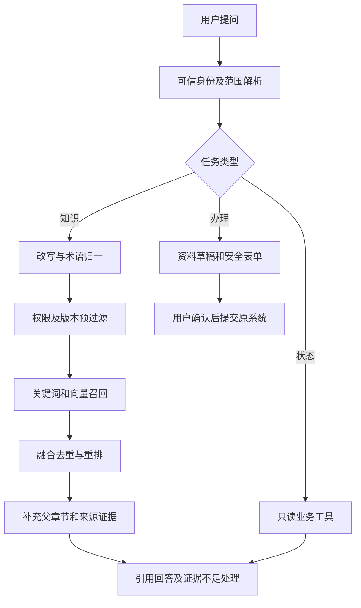
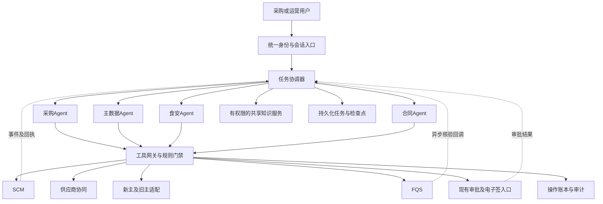

# CSX RAG 与多 Agent 业务建设方案

> 编写日期：2026-10-23。用途：业务方案、个人项目落地路线及 Agent 岗位简历准备。
> 调研根目录：`/Users/yangchen/Desktop/cqyc/ideaproject/csx`。
> 本文是基于本地项目文档与关键源码抽查形成的建设方案，不代表已完成 AI 项目、已验证线上接口或已取得业务收益。模拟数据均明确标注；拟新增工具、接口、状态和表为设计建议。

## 1. 背景与结论

CSX 已有成熟的采购、供应商协同、主数据、食安和流程系统。AI 改造的价值在于减少跨系统查资料、补资料、核对规则和追踪异常的人工操作，并复用现有系统执行交易。

建议建设两个项目，共享知识服务与工具适配层，但分别展示产品价值：

| 项目 | 面向对象 | 核心价值 | 首期闭环 |
|---|---|---|---|
| CSX 供应商合作准入 RAG 助手 | 潜在供应商、注册供应商、招商运营 | 公司知识问答、合作条件解释、材料清单、意向与注册引导 | 咨询 → 意向草稿 → 用户确认 → 原系统提交 → 查询受理状态 |
| CSX 采购与合规多 Agent 协同平台 | 采购、主数据运营、品控、合同管理员 | 跨域核对、寻源比价、合同审阅、采购下单与履约异常处理 | 自然语言采购需求 → 资料/证件/价格校验 → 候选采购方案 → 确认及业务审批 → 下单 → 跟踪 |

RAG 解决“有何依据、应如何办理”；Agent 解决“当前这笔业务如何推进”。实时价格、审批结果、订单状态、供应商冻结状态由业务接口查询，不能靠向量库回答。

首期不建议同时实现十几个自治 Agent。推荐一个任务协调器，加采购、主数据、食安、合同四个领域 Agent；寻源和履约先作为采购子流程。WMS、OMS、TMS 后续按接口成熟度接入。

## 2. 调研范围与证据可信度

### 2.1 本次实际覆盖

目录盘点发现 11 个带根 POM 的 Java 项目，另有一个没有 Java 源文件和根 POM 的同级 `csx-b2b-basic-data-task` 目录。本次对全部 11 个项目进行模块盘点，对五个重点系统阅读业务架构、关键业务说明与技术方案，并抽查主要入口及核心实现；其他项目阅读模块、README 和相关入口。

这不是逐行审计全部源码，也没有连接数据库、消息队列、生产服务或电子签平台。没有执行 Maven，没有创建或修改测试用例，没有改动原 Java 项目。

证据分三级：

- **源码确认**：找到具体入口/方法实现，可作为适配锚点；仍不能证明当前线上已部署。
- **文档说明**：来自现有业务文档，涉及详细规则和接口时仍需与代码、配置核对。
- **拟建设能力**：本文设计的新服务、新工具、Agent、检索链路和治理规则。

本地部分历史文档存在公司名称不一致、固定审批金额、固定重试次数等泛化表述。本文不将这些数字视为当前有效制度；审批阈值和重试策略必须来自实际系统配置。

### 2.2 系统职责地图

| 系统 | 调研结论 | AI 接入位置 |
|---|---|---|
| `csx-b2b-scm` | 采购申请、补货、手工下单、询比价、自动竞价、采购价格管控、合同及订单协同 | 采购 Agent、合同 Agent；通过应用服务执行，保留来源、价格、合同、证件等规则 |
| `csx-b2b-supplier` | 供应商侧合作意向、注册账号、报价议价、订货通知、预约发货和签约入口 | RAG 助手入口、供应商授权工具；不能替代主数据审核与 SCM 定价 |
| `csx-b2b-master-data` | 新主数据，商品/供应商等资料申请、审批、生效与事件分发 | 主数据 Agent；普通新品、紧急建档、简易建品、关系维护分别处理 |
| `csx-b2b-basic-data` | 旧主及兼容查询/清洗分发能力，多来源同步、编码映射、ES/Redis 查询与补偿 | 主数据查询适配、编码归一、同步状态核对；不能和新主无差别双写 |
| `fqs` | 型检、批检、自检、订单证件满足计算、原料关系、证件核验、稽核与交付 | 食安 Agent；复用规则计算、核验任务、日志及人工审核 |
| `csx-bsf-bpm` | 流程引擎及对外流程接口，另有可用性技术方案 | 人工审批/回调的候选适配对象，实际各域使用哪套流程需逐项确认 |
| `csx-bsf-flow` | 另一套流程服务及管理能力 | 存量流程适配，避免绕过节点直接改业务状态 |
| `csx-b2b-data-center` | 数据中心，覆盖多类经营、库存、采购、财务等报表入口 | 后续分析 Agent 的只读指标来源，不能代替交易系统 |
| `csx-b2b-poseidon` | 多数据源数据服务，README 明确强调轻查询职责 | 授权只读数据工具，复杂采购决策放在编排层 |
| `csx-b2b-datasecure-new` | 数据存储、脱敏规则、明文展示及审计日志入口 | 敏感字段脱敏/授权展示的候选组件，不等于已接入 AI 全链路 |
| `csx-owe-server-java` | 官网/内容展示相关入口，包含新闻、客户案例、招投标、生产加工和冷链等 | 对外知识库的候选内容来源；需取已发布、可外部公开的实际内容 |
| `csx-b2b-basic-data-task`（同级目录） | 本次未发现 Java 源文件与根 POM | 不作为独立可运行系统；真正 task 模块在 basic-data 项目内 |

本目录未发现独立 WMS、OMS、TMS 仓库，只确认 SCM/FQS 等存在对接线索。因此相关 Agent 在本文中是扩展设计，不能写成已深入调研其内部业务。

## 3. 现有业务链路及 AI 适配要点

### 3.1 供应商合作到注册

文档与入口体现两条注册链路：已有供应商编码的账号注册，以及无编码的自助注册。合作意向单是另一条前置入口，不能与正式供应商准入合并为一次调用。

1. 潜在供应商咨询公司、服务区域、合作品类和资料要求。
2. 合作意向提交会涉及企业三要素、手机号、验证码、密码及账号处理，协同调用 SCM 保存意向。
3. 无编码自助注册提交企业、联系人、银行、证照等资料，可能复用已通过意向的账号，也可能创建临时角色。
4. 已有编码注册需要校验编码、法人、税号与主数据一致。
5. 正式供应商编码生成、审核、回填及账号角色升级依赖原有业务流程和回调。

AI 可以解释、追问、提取资料、展示缺失项并形成草稿；身份核验、账号创建、准入审核仍经原系统。不能说“对话完成即自动成为正式供应商”。

### 3.2 采购下单

SCM 根据手工、补货、计划、地采、调拨等不同来源组织规则，不是通用 `createOrder` 参数填完即可下单。

关键源码表现：

- `PurchaseOrderCreateController` 提供商品行组装与提交入口。
- `ManuallyCreateOrderService#createOrder` 包含来源转换、公共数据补齐、价格/优势率校验和调用统一创建流程。
- 返回成功响应仍可能包含价格预警；只有拿到真实采购单号并回查成功才能宣告下单成功。
- `CommitPurchaseOrderService` 包含事务提交、订单及需求关系的后置处理。
- `PurchaseOrderCreateHandler` 承接后续外部协同；创建订单和所有下游同步完成应分别展示。

Agent 工具必须保留 `sourceType`、业务类型、地点、采购组织、供应商、商品、单位、数量、价格来源等语义。首期只开放“手工供应商采购”一种来源，其他场景逐步适配。

### 3.3 询比价与自动竞价

SCM 已有询价、成本价/到仓价、议价、评议、中标价格池及自动竞价策略入口；供应商协同负责供应商侧报价和回传，最终价格形成在 SCM。

AI 的新增价值是识别需求、筛选候选、解释价格差异、形成策略草稿和异常提醒。既有自动竞价程序继续负责时间窗、截止处理、评议和中标规则。不得把现有自动竞价逻辑包装成新研发的大模型能力。

采购 Agent 与供应商助手须使用不同身份和数据范围。采购内部限价、其他供应商报价、评议意见不能作为供应商知识库内容，也不能由同一任务替多个竞争主体作出报价。

### 3.4 主数据申请与分发

新主数据承担治理，旧主及同步查询层承担兼容与分发。普通商品建档通常包含申请、审核、主档生效、编码回传与外部同步；紧急建档、简易建品和部分关系维护存在不同路径，不能统一声称“全部主数据变更都走同一审批”。

`ProductBrandController` 的实现调用品牌服务；品牌、单位等字典由工具查询，不让模型自由造编码。商品是否可采购还要检查地点经营档、供应商商品关系、区域状态、单位换算与税务资料。

`DefaultMediator#saveAndPublish` 先保存通知，再发布进程内通知并关联事务完成；配套发布器负责后续 MQ 投递。AI 平台应观察最终生效及同步结果，不自行向所有下游重复发布事件。

### 3.5 食安

型检、批检、自检是不同证件来源；订单证件满足结果还取决于客户、地点、商品、批次、供应商、BOM/原料等关系。图片上传、核验通过、业务审核通过、订单证件满足是不同结果。

FQS 已存在 `CertificateExternalAiVerificationServiceImpl`，代码包含千问识别、百度篡改/标识/二维码能力及规则分支；`CertificateQrAsyncVerificationServiceImpl` 包含异步启动、回调、取消与批次收口入口。已有 AI 调用属于原系统基础能力，本项目拟实现的是跨域协同与结果解释。

原料关系与商品映射已有维护/查询能力。AI 可以给出候选和匹配依据，但相似名称不代表可直接替代原料、建立 BOM 或绑定证件；物种、规格、生产商、供应商、单位及地点须经业务规则验证。

## 4. 目标与需求范围

### 4.1 首期目标

1. 给供应商一个可追溯、能引导下一步的知识与准入入口。
2. 给采购一个能够跨域取证、形成可执行采购草案的入口。
3. 每个写操作可确认、可审计、可恢复，结果以业务回执为准。
4. 用脱敏业务数据和模拟适配器完成个人可演示版本，逐步接入授权环境。
5. 产出可讲清业务规则、技术难点和验证方法的两个简历项目。

### 4.2 首期范围

RAG：公开公司资料、合作指南、注册操作、材料清单、证件上传指引；登录后本人办理进度查询与意向草稿辅助。

多 Agent：手工供应商采购需求、候选商品及供应商核对、价格方案、证件缺口、合同要素审阅、下单确认与状态追踪。

暂缓：真实付款、自动签章授权、自动冻结/解冻、自动建立替代原料关系、全场景补货优化、自由 SQL、任意 HTTP 工具和全企业自治运营。

## 5. 项目一：供应商合作准入 RAG 助手

### 5.1 产品场景

| 用户问题/操作 | 处理方式 | 输出 |
|---|---|---|
| 公司服务哪些客户，有哪些合作模式？ | 已发布公开内容检索 | 有出处的介绍；无资料时说明缺口 |
| 我做某地区冷冻肉类，如何合作？ | 意图识别 + 区域/品类追问 + 已审核指南 | 办理入口、适用前提、材料清单；不承诺采购量 |
| 营业执照和检测报告是否都需要？ | 指南检索 + 登录后配置工具 | 区分通用材料与当前供应商/品类要求 |
| 帮我填写合作意向 | 结构化槽位收集 + 草稿 | 可编辑确认卡片，不自动提交 |
| 我有编码/没有编码，如何注册？ | 确定链路 + 安全表单 | 分支说明与原系统核验结果 |
| 为什么申请被退回？ | 本人权限下的状态工具 + 原因解释 | 原始驳回原因、补正项、提交入口 |
| 我的订单缺什么证？ | 本人订单工具查询 FQS | 截止查询时刻的缺口；不能仅凭 FAQ 判断 |

### 5.2 知识来源与发布边界

| 知识层 | 候选来源 | 发布范围 |
|---|---|---|
| 公开公司知识 | 官网系统已发布介绍、新闻、客户案例、招投标及经授权宣传册 | 匿名访客 |
| 供应商办理指南 | 合作意向/注册说明、材料模板、操作手册及 FQS 上传指引 | 依审核后的公开/登录范围 |
| 供应商私有业务资料 | 本供应商合同、本人申请、订单和证照记录 | 本供应商及授权子账号，优先实时工具 |
| 内部运营知识 | 招商审核规则、采购与食安处理手册 | 内部员工 |
| 开发技术知识 | 本次读到的源码、技术方案、SQL、接口结构 | 开发/运维隔离库，不进入供应商库 |

本次只确认代码存在对应内容入口，没有取得官网业务库中的实际介绍、政策、联系人和客户案例。不能以内部技术文档直接生成“公司官方合作承诺”。需由业务人员提供并审核可发布语料。

### 5.3 入库流程


- 文本按业务主题、标题层级和规则单元分块。首次可从 400～800 tokens 范围试配，最终由检索效果决定；表格保留列头、适用条件和单位，不能把“例外”从规则正文切掉。
- 图片说明用于辅助检索；报告名称、数值、日期等关键内容保留原图/页码位置，不能只存模型摘要。
- 每块记录建议字段：`doc_id`、`version`、`chunk_id`、标题路径、页码/行号、源地址、内容哈希、发布状态、生效/失效时间、适用地区/品类、租户、角色与供应商范围。
- 公开企业级通用文档可设置独立公共范围；私有文档必须有明确租户及主体归属，缺失时禁止发布。
- 同一文档修订采用新版本构建完成后切换有效版本；删除/撤回时同时影响关键词、向量、缓存和引用下载授权。

### 5.4 检索与回答



关键词召回处理供应商编码、商品编码、证件名和精确术语；向量召回处理自然语言表达。推荐采用关键词与向量双路召回、融合、重排，再向模型提供少量高相关证据。首期可用独立轻量关键词索引，后续按规模选择 ES，避免默认直接连接企业生产 ES。

建议回答协议包括：结论、适用范围、材料/步骤、来源与版本、查询时间、下一步。证据不足、资料冲突或已过期时返回明确缺口；不要仅凭相似度分数决定事实可信度。

检索策略：有正式业务发布来源时优先于开发说明；同范围使用有效版本。出现无法裁定的冲突时展示差异并转运营处理。模型补充的解释与原文要求分开呈现。

### 5.5 对话办理的状态与字段

拟新增状态：咨询 → 信息收集 → 草稿待确认 → 安全验证 → 提交中 → 已受理 → 等待审批/补正 → 完成。它们是 AI 工作流状态，不是原系统枚举。

合作意向草稿可收集企业名称、经营品类、供货区域、生产/经销性质、供货能力、合作描述；实际必填字段以现有 DTO 和业务校验为准。正式注册的银行账户、法人等敏感资料通过受控表单输入。密码、短信验证码不进入 LLM、向量库、长期记忆或明文日志。

草稿确认前展示差异和受理系统。确认只授权本次具体提交，不等于批准后续合同或采购操作。后端把 `draft_id + version + 内容哈希` 与验证会话绑定；草稿改变后原确认失效。

### 5.6 权限、更新及风险控制

- 匿名阶段只查公开知识。登录后从服务端身份获取租户、供应商和子账号范围；不能接受模型自行提供的身份字段。
- 所有召回、重排、父文档扩展、引用预览、工具查询和缓存均执行相同权限规则，缓存键包含范围及知识版本。
- 注册中的临时账号与正式供应商账号分开授权；没有正式编码时按申请归属校验。
- 文档文字和附件内容只作为证据，不允许“忽略规则”等内容改变工具权限或系统指令。
- 私有资料不因曾在聊天出现就转为永久记忆；权限撤销后，恢复历史会话仍须重新检查可见范围。

## 6. 项目二：采购与合规多 Agent 协同平台

### 6.1 Agent 分工

| Agent/组件 | 输入 | 主要职责 | 结构化输出 |
|---|---|---|---|
| 任务协调器 Supervisor | 自然语言目标、用户权限 | 拆任务、检查依赖、路由、聚合、等待确认与回调 | 任务 DAG、执行状态、证据索引 |
| 采购 Agent | 需求、地点、数量、交期、预算 | 商品澄清、寻源方案、价格比较、采购草案、下单与跟踪 | 采购计划、成本明细、执行回执 |
| 主数据 Agent | 商品/供应商/品牌资料 | 编码匹配、去重、地点档核对、申请草稿、同步结果核对 | 有效主体/商品、缺口、申请号 |
| 食安 Agent | 商品、供应商、地点、订单/批次、附件 | 应传证件查询、核验任务、缺口解释、原料匹配建议 | 规则结果、证件证据、待办 |
| 合同 Agent | 合同模板/文本、订单要素 | 模板检索、要素提取、与主数据/价格交叉核对、条款差异说明 | 草稿、风险项、引用条款和页码 |
| 工具网关/策略模块 | 工具请求、可信身份 | 授权、参数校验、幂等、限流、业务调用和审计 | 标准结果与业务回执 |
| 后续 OMS Agent | 销售需求与订单 | 需求汇总、交期冲突、销售需求映射 | 经授权需求建议 |
| 后续 WMS Agent | 库存、批次、预约/收货 | 库存查询、批次与收货异常解释 | 库存证据、仓内待办建议 |
| 后续 TMS Agent | 时效、运输状态 | 到货时间核对、运输异常协同 | 时效依据、异常处理建议 |

领域 Agent 有独立的业务目标、工具范围和领域上下文；不需要各建一套大模型实例。固定计算、授权、审批结果判断和交易执行由确定性模块完成，不为每个校验器增加一个 Agent。

### 6.2 协作架构



主数据身份先确定，再并行读取适用证件、报价和合同。需要新建主数据时暂停交易路径，等待资料生效与下游可见。Agent 共享结构化结果和证据 ID，不把完整聊天记录广播给所有领域。

### 6.3 采购主流程

1. **需求澄清**：提取地点、商品意图、质量要求、数量、单位、交期、预算、税价口径。缺少关键字段时追问；相对日期转为绝对日期确认。
2. **主数据核对**：匹配真实商品编码、地点经营档、单位换算、有效供应商及区域状态；多个候选时展示差异，不自动选相似名称。
3. **证件与合同并行核对**：食安查询实际配置、核验结果和缺口，合同侧核对主体、范围、有效期及关键交易要素。不同采购场景何时阻断必须沿用现有业务规则。
4. **寻源与成本比较**：读取有效周期价/中标价格/授权报价，统一单位、税价、运输费和有效期，由程序计算候选方案。
5. **生成采购草案**：列出供应商、商品、数量、价格、地点、交期、成本及证据版本，调用业务预检。预检只是时间点结果，不能替代提交时校验。
6. **确认与业务审批**：用户确认具体草案；如原业务要求审批，则提交原流程并等待真实结果。AI 确认不能冒充审批通过。
7. **提交执行**：再次检查最新主数据、价格、证件、合同及授权，带幂等键调用 SCM；数据变化时返回新草案重新确认。
8. **核对回执**：只有单号存在且回查成功才标记已创建；供应商通知、WMS/FQS 等协同状态单独记录。
9. **履约跟踪**：等待原系统事件或授权查询；发现预约、发货、入库、证件或交期异常时生成待办建议。改量、换供应商、取消等操作需独立授权。

### 6.4 合同 Agent

合同能力拆为两个阶段：

- **先审阅**：读取授权合同，提取甲乙方、商品/品类范围、地区、价格口径、有效期、付款条件、交付、验收、质量责任、违约条款；与主数据、报价、采购草案进行结构化比对，输出“风险项—原文页码—业务差异—修改建议”。
- **后起草**：基于经过业务/法务批准的模板和条款库填充草稿，变量值来自已确认数据；保留版本和逐条变更。付款、责任、赔偿等实质条款由相应负责人审核。

现有上上签/法大大用于实际签约。签署链接生成、发起签约、自动签章授权都属于写操作，不能因为接口是 GET 就视为只读。Agent 首期只做审阅和草稿，电子签执行作为后续受控能力。

### 6.5 食安 Agent

输出必须包含：业务对象（含租户、供应商、地点、商品、订单/批次）、要求的证件类型、命中的配置、已上传版本、系统核验状态、业务审核状态、最终满足状态、缺失原因、查询时间。

区分技术失败与业务不符合：超时/无法识别不是证件造假；核验服务返回失败不能当作自动驳回的充分依据。遵循当前 FQS 业务分支并给出待人工复核项。

二维码/多页报告复用已有任务流程，绑定上传版本、文件哈希、任务 ID 与核验轮次。旧文件回调不能覆盖新上传结果，重复回调不能重复推进业务；取消任务的晚到回调需忽略或仅留痕。

原料匹配按“候选召回 → 属性校验 → 展示依据 → 业务确认 → 既有维护入口”处理。仅做名称相似度不能认定原料相同或证件可共用。

### 6.6 竞价与成本优化

首期从“建议”开始：识别报价过期、供货能力不足、单一来源、异常价格和可合并采购需求；推荐询价商品、供应商范围、城市、时间窗和策略草稿。

发布询价、改自动竞价策略、确认评议、中标等分别作为受控业务动作。自动竞价执行复用 SCM，不允许 LLM 随意变更报价截止时间、价格保密范围或评议规则。

成本比较必须在硬约束可行之后进行。候选需满足商品与单位一致、供应商准入、适用地点、交期、合规及报价有效期；缺失关键运费/税价字段时只展示不完整比较并要求补齐。

## 7. Tool Use 设计与原系统映射

下表工具名均为**拟新增 AI 工具**，不是已有接口名。原代码只提供适配锚点；需继续核对部署应用、鉴权、DTO、错误码和真实调用链后实现。

| 拟新增工具 | 原系统锚点 | 模式 | 关键限制 |
|---|---|---|---|
| `knowledge.search` | 拟建检索服务 | 只读 | 服务端注入范围和有效版本 |
| `supplier.intention.prepare` | 协同 `SupplierCooperateIntentionController/Service` 对应资料模型 | 草稿 | 新增能力；不调用真实提交做预览 |
| `supplier.intention.submit` | `/supplier/cooperate/submit` | 写 | 原接口含验证/账号动作，需安全表单与业务适配 |
| `supplier.registration.status` | 自助注册与账号回调相关服务 | 只读 | 申请归属与临时角色权限 |
| `master.product.resolve` | 新主商品查询、旧主 `ProductProvider`/编码映射 | 只读 | 来源明确、地点档、有效性与单位 |
| `master.supplier.eligibility` | 新主大区状态与旧主供应商查询 | 只读 | 公司、大区、冻结/清退和同步时间 |
| `master.product.application.prepare/submit` | `ProductApplyController`、审批应用服务 | 草稿/写 | 区分普通、紧急、简易路径，不默认放行 |
| `master.brand.search/prepare` | `ProductBrandController` 及品牌服务 | 读/草稿 | 去重、有效性、授权；创建是单独写操作 |
| `food.certificate.requirements` | FQS 型检/批检配置及订单证件查询 | 只读 | 商品、地点、供应商、订单/批次维度 |
| `food.certificate.verify.start/status` | 现有外部 AI 核验和二维码异步服务 | 写/读 | 返回任务号，保留核验/审核/满足不同状态 |
| `food.raw.match.suggest` | `ProductRawRelationService`、`ProductMappingService` | 建议 | 不自动更新原料关系 |
| `sourcing.quote.compare` | SCM 询比价与有效价格查询 | 只读计算 | 数值由程序计算、数据按身份可见 |
| `sourcing.inquiry.prepare/publish` | `InquiryManagementController` | 草稿/写 | 供应商范围、时间窗及权限；发布需确认 |
| `sourcing.strategy.prepare` | `AutoBiddingPriceController` | 草稿 | 不映射调试入口、不自动修改策略 |
| `contract.review/draft` | 合同文本、正式合同查询、批准模板 | 只读/草稿 | 内容版本绑定、引用条款，不执行签章 |
| `procurement.order.preflight` | `PurchaseOrderCreateController`、创建规则链 | 预检 | 需新增无副作用封装，不调用提交模拟 |
| `procurement.order.submit/status` | `ManuallyCreateOrderService`、订单查询 | 写/读 | 价格预警不是成单；下游同步单独核对 |
| `fulfillment.exception.explain` | SCM/协同订单、预约、发货、入库查询 | 只读 | 不能自行改仓内或物流状态 |

### 7.1 标准协议（建议新增）

工具请求分为三部分：服务端可信上下文、业务参数、执行控制。`tenant_id/shipper_code`、用户、角色、供应商范围由网关生成，不能由模型覆盖。

```json
{
  "tool": "procurement.order.submit",
  "run_id": "sim-run-001",
  "task_id": "sim-task-001",
  "draft_id": "sim-draft-001",
  "draft_version": 2,
  "approval_ref": "sim-approval-001",
  "idempotency_key": "opaque-server-generated-key",
  "arguments": {"plan_ref": "sim-plan-001"}
}
```

上述示例只引用服务端保存的计划，避免模型临时替换被批准的金额/供应商。实际模型仅提出工具调用，网关加载可信上下文并校验确认和审批凭证。

结果建议包含 `status`、`business_code`、脱敏消息、`data`、`evidence_refs`、业务单号、任务号、查询时间、`retryable` 和 `next_action`。拟定状态：`SUCCEEDED`、`WARNING`、`REJECTED`、`PENDING`、`UNKNOWN`；它们是 AI 适配协议，不能直接写入原业务表。

工具只有实际收到订单号才返回创建成功；超时不明返回 `UNKNOWN`，后台查单核实；异步核验返回 `PENDING` 和任务号。

### 7.2 执行授权

| 类型 | 示例 | 默认策略 |
|---|---|---|
| 只读 | 查询商品、证件缺口、合同列表 | 权限校验后执行 |
| 无外部副作用草稿 | 意向、采购、询价、合同草稿 | 可自动生成，供用户审阅 |
| 业务写入 | 正式提交意向/申请、采购下单、发布询价 | 绑定草稿的用户确认，按原规则走业务审批 |
| 高影响操作 | 发起签署、自动签章、付款、冻结/解冻、永久状态变化 | 首期关闭，后续单独设计授权与权限 |

未来允许有限自动下单时，必须有业务预先批准的授权策略，明确预算、供应商、品类、地点、时间、单笔/累计上限及撤销方式；不能把用户一句“帮我采购”视为无限授权。

## 8. 状态、事务、幂等与恢复

### 8.1 任务模型

建议任务状态：`DRAFT → PLANNED → RUNNING → WAITING_INPUT / WAITING_APPROVAL / WAITING_EXTERNAL → SUCCEEDED / PARTIAL / FAILED / CANCELLED`。

每个任务节点保存输入引用、业务对象版本、规则结果、证据、工具调用 ID、业务单号、错误分类和重试情况。检查点保存执行状态；业务事实以权威系统为准。恢复任务时重新检查身份、权限和草稿版本。

### 8.2 持久化与消息

LangGraph 用于显式节点和条件路由，采用持久化 checkpointer，支持等待人工输入和恢复。官方文档区分线程检查点与跨线程长期存储，内存 checkpointer 无法在重启后保留任务：[持久化说明](https://docs.langchain.com/oss/python/langgraph/persistence)。

人工确认可用 interrupt 等待外部输入，但确认记录和权限判断必须由应用保存并校验，不能仅依赖聊天文本。官方要求持久化检查点和稳定线程标识：[中断与恢复](https://docs.langchain.com/oss/python/langgraph/interrupts)。

AI 检查点不能保证外部交易只执行一次。下单、提交申请等副作用放在独立执行节点，配合业务幂等及操作账本；不要把有副作用的调用混在会因恢复而重新运行的确认节点中。

### 8.3 事务与一致性

- 单系统内复用原应用服务事务；不在 Python 编排层开启跨 SCM/MDM/FQS 的大事务。
- 跨系统通过任务状态、原有事件/回调和查询核对达到最终一致，消费方按事件 ID/业务版本去重。
- 新主审批成功后等待编码及目标系统可见；“审批通过”和“下游已同步”分别记录。
- 草稿过期或基础数据版本改变时重新预检；预检与写入间仍由业务系统执行原子校验。
- 跨系统部分成功时显示已完成业务对象，保留未完成节点；取消订单、撤回申请是新的业务命令，不承诺数据库自动回滚一切。

### 8.4 写入幂等的必要条件

幂等键应包含租户、业务动作与稳定业务请求身份，唯一约束保障并发请求不能重复执行。操作账本记录 `PREPARED/EXECUTING/SUCCEEDED/UNKNOWN/FAILED` 等拟定状态。

仅在 AI 网关写一张幂等表，不能彻底解决“业务已提交、网关未记成功就崩溃”的窗口。真实联调前必须确认下游支持客户端请求号/唯一外部单号，或在业务事务内增加可查询的请求映射。若不能可靠查明结果，则停为 `UNKNOWN` 转人工核实，不自动重试创建。

### 8.5 异常与冲突

| 场景 | 处理 |
|---|---|
| 商品名称匹配多个编码 | 主数据 Agent 提供候选，等待用户选定 |
| 主数据 Agent 允许、食安存在缺口 | 按原场景规则阻断/待办；不能由协调器多数表决放行 |
| 合同主体不一致或合同过期 | 给出差异与证据，先处理合同或人工确认适用路径 |
| 最低价供应商交期不满足 | 从可行候选中排除，展示原因和其他方案 |
| 用户确认后报价变化 | 草稿失效，重新计算和确认 |
| 下单超时且无业务回执 | 查单与对账，不重复创建 |
| 核验服务不可用 | 技术失败待处理，不冒充核验通过或证件造假 |
| 旧版证件回调晚到 | 校验文件与轮次，仅留痕，不覆盖新版 |
| 单节点一直失败 | 有限重试、熔断、待人工处理，避免 Agent 无限循环 |

## 9. 两条模拟业务演示

所有名称、金额和状态均为演示假设，不能写成 CSX 实际价格、准入条件或业务成果。

### 9.1 演示 A：潜在供应商咨询并提交意向

用户：“我们在四川做冷冻牛肉，想和 CSX 合作，需要什么？”

1. 系统从已审核的演示公开知识库解释公司及合作入口，附文档版本和出处。知识没有该地区政策时明确说明需进一步确认。
2. 对话补齐企业性质、经营品类、供货区域、供货能力，形成意向草稿。
3. 展示已收集字段、待补材料、提交目的和账号说明。
4. 用户通过安全表单完成短信/身份验证；密码和验证码不送入模型。
5. 用户确认后，模拟适配器返回 `SIM-INTENT-0001` 和“已受理，待审批”。真实模式才调用协同原接口。
6. 用户问“是否已经合作成功”，助手回答仍待原业务审核；不得把受理当准入。

演示看点：引用来源、上下文追问、结构化草稿、身份验证边界、受理回执、状态解释。

### 9.2 演示 B：采购 1,000 kg 商品并处理证件缺口

模拟需求：某租户某仓采购指定规格冷冻牛肉 1,000 kg，明确绝对交期；同一商品、质量标准、税价口径一致。主数据工具已返回可采购候选，运费为本次订单总额。

| 候选 | 模拟含税单价 | 模拟运费 | 模拟到仓成本 | 前置条件 |
|---|---:|---:|---:|---|
| A | 40.00 元/kg | 800 元 | 40,800 元 | 假设当前场景必需证件缺失 |
| B | 41.00 元/kg | 0 元 | 41,000 元 | 假设证件/合同/交期均满足 |
| C | 39.50 元/kg | 1,000 元 | 40,500 元 | 假设无法满足交期 |

程序计算：`含税货款 + 同口径运输费`，本例不包含未提供的损耗/仓储/融资成本。A 缺少该场景硬性证件，C 交期不满足，因此当前选择 B。不能把最低标价等同于最低可行采购成本。

协作过程：

1. 主数据 Agent 确认商品/供应商/地点档，返回编码与版本。
2. 食安和合同 Agent 并行取证；采购 Agent 比较有效价格，形成 B 的草案。
3. 若 A 后续补齐证件，复用 FQS 核验和重算，取得满足结果后再生成新方案。A 比 B 的模拟到仓成本低 200 元，降幅约 0.49%；这是候选方案差额，不是已实现降本。
4. 用户确认某一方案并完成必要审批后执行，模拟返回 `SIM-PO-0001`；真实环境必须返回真实采购单号。
5. 重复提交应得到同一执行结果。网络不明时显示“结果核实中”。
6. 履约模块演示供应商预约/发货/入库事件，以及订单创建成功但协同失败的部分完成状态。

补充展示：合同主体不匹配、商品需先建档、证件更换产生旧回调等情况可作为后续演示分支；本次只设计流程，没有创建相应测试用例或数据集。

## 10. 技术实现建议与当前项目复用

### 10.1 推荐边界

| 层 | 建议 | 说明 |
|---|---|---|
| 界面 | Vue 3 对话、引用、草稿及执行状态卡片 | 可沿用当前工作区管理端基础 |
| AI 应用 | Python 3.11+、FastAPI、LangGraph | 负责检索和任务编排，独立于存量 Java 运行时 |
| Java 适配 | 独立 Spring Boot 工具网关/各域 adapter | 接 REST/Feign/Dubbo，复用原应用服务与身份体系 |
| 检索 | BGE-M3 向量、关键词召回、独立重排 | 不把新增双路召回和重排说成已有功能 |
| 存储 | Milvus、对象存储、Redis、关系数据库 | 向量/附件、缓存队列、业务元数据及执行账本分开 |
| 模型 | 文本模型、多模态模型经统一适配 | 按准确性、时延、成本实测选型，避免业务逻辑绑死厂商 |
| 消息与观察 | 原有 RocketMQ/业务回调、trace 与指标 | 网关失败、业务失败与模型失败分开统计 |

Java 存量项目普遍 Java 11，不为接 AI 强迫全部升级。建议先采用 Python 编排 + Java 网关复用业务，避免因引入需要不同 JDK 的新 AI 框架影响存量应用。具体依赖版本和部署方式在实现阶段锁定。

Milvus 支持不同层级的多租户策略；本文建议公开库与私有库分开，私有检索强制租户/主体范围过滤，规模扩大再评估独立库/集合。分区本身不能替代应用授权，选择须与实际版本匹配：[Milvus 官方多租户说明](https://milvus.io/docs/multi_tenancy.md)。

### 10.2 与当前 `cqyc-askme` 的关系

当前工作区 README 与实现已具备管理员登录、PDF/Markdown 导入、任务进度、图片增强、语义分块、向量写入代码，使用 MinerU、BGE-M3、MinIO、Milvus、Redis 和 LangGraph 导入节点。

当前 README 同时明确：外部服务待部署联调，公开问答尚未实现。不能把已有导入工作流等同于已完成企业 RAG，更不能把 LangGraph 导入节点称为多 Agent 平台。

可复用：文档接入、文件哈希、阶段恢复、图片对象存储、分块和导入进度。

需新增：企业身份及权限、发布审批与版本撤回、关键词召回/融合/重排、引用问答、意向草稿、安全办理表单、领域 Agent、工具网关、持久化任务、审批/回调、幂等和业务审计。当前管理员登录不能直接充当企业供应商或采购身份。

建议先建立两个逻辑应用：`csx-supplier-rag` 和 `csx-procurement-agents`，共享知识 SDK 与标准工具协议。它们是拟定名称，无需首期拆出大量微服务。

### 10.3 拟新增模块与数据

建议目录：`knowledge/`、`supplier_onboarding/`、`agents/`、`workflows/`、`tools/`、`policy/`、`persistence/`、`observability/`；Java 网关按 controller、application service、adapter/client、DTO、repository 分层。

拟新增业务表：文档/版本/发布范围、问答与引用、资料草稿、Agent 运行/任务/工具调用、确认/审批引用、外部回调 inbox、执行 outbox。模型检查点由所选持久化组件管理，不臆造其内部表结构。

本阶段不提供可直接执行 DDL：数据库类型、租户框架、字段规范和部署尚待确认。SCM 仓库约定业务表 `shipper_code/shipper_name`、全局表排除配置；AI 新存储不能假设 BSF 会自动隔离，应明确实现。应用中的 `tenant_id` 与既有 `shipper_code` 必须建立可信映射。

### 10.4 配置、日志和回退

建议开关语义：只读模式、模拟/真实适配器、工具允许清单、写操作开关、模型与检索预算、超时、有限重试、知识版本。具体 key 后续实现时定义；真实写默认关闭。

日志记录 trace/run/task/tool、租户范围标识、脱敏业务 ID、输入哈希、草稿版本、耗时、规则结果和错误码。不得记录密码、验证码、令牌、银行账号、完整注册请求或带授权参数的文件链接。现有代码个别入口使用请求整包日志，接入时应专项检查，不能照搬。

关停 AI 写入后，原页面和原审批可继续使用；已创建业务单据保留并核对状态。停用某工具不删除历史审计。RAG 发布错误时撤回版本及缓存；模型不可用时保留业务系统入口与任务记录。

## 11. 落地阶段与验收依据

| 阶段 | 建设内容 | 可交付证据 |
|---|---|---|
| P0 业务基线 | 授权资料、术语、主体/商品编码、接口清单、模拟/真实边界 | 已审核知识样本、工具契约、脱敏规则 |
| P1 RAG 最小闭环 | 导入、发布、双路检索、重排、引用、证据不足、权限过滤 | 可运行问答演示、检索日志及标注方案 |
| P2 供应商准入 | 多轮草稿、安全表单、确认、模拟提交及进度查询 | 可重复演示的意向办理流程 |
| P3 多 Agent 只读 | 协调器、采购/主数据/食安/合同 Agent、成本计算 | 跨域方案、证据链、任务可视化 |
| P4 模拟交易与恢复 | 确认、业务审批模拟、幂等、回调、未知结果核对 | 模拟订单与操作账本、恢复记录 |
| P5 授权环境联调 | Java 真实适配、小范围只读再写入 | 真实接口回执与业务验收记录 |
| P6 扩展 | 竞价建议、主数据申请、WMS/OMS/TMS | 每域单独验收，避免一次性扩张 |

不承诺固定工期；真实接口、审批规则、可发布知识与部署条件决定进度。用于简历的最小版本建议完成 P1～P4，并准确标明采用模拟适配器；只有完成 P5 才写已接入企业业务系统。

### 11.1 指标口径（设计建议，暂无实测值）

| 类别 | 指标 | 如何解释 |
|---|---|---|
| 检索 | Recall@K、MRR/nDCG | 用业务标注的证据命中和排序衡量，不只看回答流畅 |
| 回答 | 事实正确率、引用支持率、无依据回答率 | 每个关键结论有可访问的正确证据 |
| 安全 | 跨租户/跨供应商信息暴露数 | 包括召回、缓存、引用、附件、历史恢复各阶段 |
| 办理 | 草稿完整率、受理成功率、材料补正率、流程耗时 | 排除放弃和外部故障等因素后分别统计 |
| Agent | 任务完成率、工具参数正确率、人工接管率 | 以业务目标及实际回执衡量 |
| 可靠性 | 重复业务写入数、未知结果收敛率、恢复成功率 | 与下游查单能力一起衡量 |
| 性能成本 | 首字/完成 P50/P95、检索/重排/模型耗时、单任务成本 | 固定数据、并发及配置下采集 |
| 经营收益 | 人均处理时长、可比采购成本差异、履约异常处理时长 | 有对照基线、足够样本和观察期再写简历 |

数据集应覆盖日常表述、业务术语、时间版本、地区/品类差异、无答案和权限边界，并由业务人员标注。先制定口径，得到用户确认后再创建测试用例或评测数据集并执行验证；本次未生成。

## 12. 已确认规则与待确认问题

### 已确认

- 供应商协同已有合作意向/注册/签署及供应商履约入口，正式准入和主档不由聊天系统决定。
- SCM 已有采购规则和价格管控、询比价及自动竞价基础，应优先封装复用。
- 新主与旧主职责和数据流不同，需要按领域确认权威来源。
- FQS 已有 AI 证件核验及异步任务基础，订单证件满足是独立计算结果。
- 当前工作区已有导入基础，但完整 RAG 和多 Agent 尚待建设。

### 实现前必须确定

1. 个人脱敏演示还是企业授权试点；哪些资料允许离开公司网络、允许交给哪些模型。
2. 可发布公司知识、合作政策、材料清单及业务审核负责人。
3. 租户、用户、供应商主/子账号身份如何签发及传递到 Java 适配器。
4. 新主/旧主各领域与新旧链路的权威读写入口、编码归一及同步时效。
5. 首期采购来源、必需字段、单位/税价/运费口径和生效规则。
6. 真实接口鉴权、DTO、错误码、业务预警和无副作用预检的实现方式。
7. 下单是否支持请求号和查询映射，如何消除超时重复创建窗口。
8. 各场景的食安强控发生在采购、发货还是交付阶段；人工审核和自动核验的真实关系。
9. 合同模板和条款库的批准范围，电子签操作权限及流程。
10. 哪些实际审批由 BPM、旧 flow 或主数据内部审批处理，如何订阅结果。
11. 模型、关键词索引、向量库和检查点数据库的部署资源与版本。
12. WMS/OMS/TMS 接口及样例数据是否可用，是否另有仓库可调研。

当前核心待决策项超过五个，因此本文达到**业务架构与原型建设方案**深度，尚不能直接执行生产系统改造。个人演示可先通过模拟模式推进，不能把未确认接口当真实接口使用。

## 13. 简历与面试定位

两个项目简介、职责和讲解重点见同目录《两个AI项目简介与简历写法.md》。当前可使用“方案设计/建设中”的口径；完成后根据真实交付改成“实现”，所有覆盖量、准确率、时延、降本比例均需来自可复查记录。

最有价值的业务辨识度是：供应商意向与正式准入分离、申请态与主档态分离、新旧主数据兼容、价格来源与采购场景相关、证件核验与订单满足分离、AI 确认与业务审批分离、任务恢复与交易幂等分离。

## 14. 后续 AI 开发执行指令

1. 先读本方案、证据索引、目标项目 CLAUDE/AGENTS，核对已有本地改动。
2. 优先完成公开脱敏 RAG 和模拟工具；真实模式使用独立配置且默认禁写。
3. 按领域追 Controller/Provider → Service → Repository/Mapper → Client/事件/任务，不跳过原有业务规则。
4. 先定义协议和业务门禁，再实现领域 Agent；遇到第 12 节未确认项，只推进不依赖该项的工作。
5. 对关键业务、复杂分支、边界条件写准确注释；重要状态、失败及恢复路径写脱敏日志。
6. Java 外部依赖优先在 `/Library/zdsoft/csx-repository-dev` 查找。执行 Maven 编译/测试/打包/安装前须询问用户并获得确认。
7. 创建、编写、修改测试用例前须询问用户并获得确认；不要把代码里的测试命令当成本次授权。
8. 交付时说明新增能力、复用能力、模拟边界、未验证部分及可复查结果，不生成虚构业务收益。

## 附：阅读依据

仓库文档、具体源码与行号见《调研证据索引.md》。外部文档仅用于核对编排/检索产品能力；CSX 业务结论来自本地阅读，不以通用技术文档推断公司制度。
